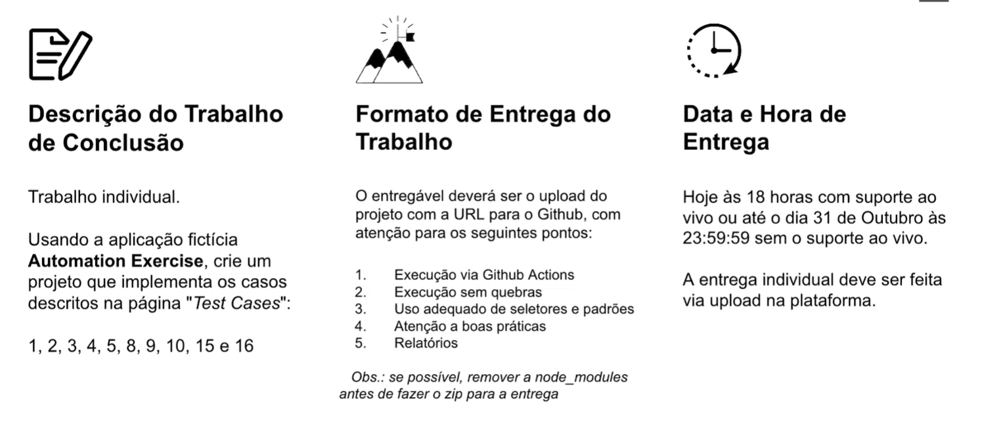

# Automação Web com Cypress

Projeto de automação end-to-end da aplicação [Automation Exercise](https://automationexercise.com/), desenvolvido com Cypress.

## Casos de teste automatizados

Foram implementados os seguintes casos:

- Test Case 1: Register User
- Test Case 2: Login User with correct email and password
- Test Case 3: Login User with incorrect email and password
- Test Case 4: Logout User
- Test Case 5: Register User with existing email
- Test Case 8: Verify All Products and product detail page
- Test Case 9: Search Product
- Test Case 10: Verify Subscription in home page
- Test Case 15: Place Order: Register before Checkout
- Test Case 16: Place Order: Login before Checkout

## Pré-requisitos

- Node.js 20 ou superior
- npm
- Git

## Instalação

Clone o repositório e instale as dependências:

```bash
git clone https://github.com/hanrrisonoliveira/pgats-automacao-web-2026.git
cd pgats-automacao-web-2026
npm install
```

## Executar o Cypress

Para abrir a interface do Cypress:

```bash
npx cypress open
```

Para executar todos os testes em modo headless:

```bash
npm run cy:run:headless
```

Para executar apenas o arquivo do trabalho final:

```bash
npm run cy:run:trabalho-final
```

O comando headless executa os testes sem abrir a interface gráfica do Cypress.

## Relatório Allure

Após executar os testes, os resultados são gerados na pasta `allure-results/`.

Para gerar o relatório HTML:

```bash
npx allure generate allure-results --clean -o allure-report
```

Para abrir o relatório localmente:

```bash
npx allure open allure-report
```

Também é possível gerar e abrir o relatório diretamente com:

```bash
allure serve allure-results
```

As pastas `allure-results/` e `allure-report/` são geradas automaticamente e estão configuradas no `.gitignore`.

## GitHub Actions

A pipeline está disponível em [.github/workflows/cypress-trabalho-final.yml](.github/workflows/cypress-trabalho-final.yml) e executa somente:

```text
cypress/e2e/1-getting-started/trabalho-final.cy.js
```

Ela é executada automaticamente em `push` e `pull_request`, além de permitir execução manual:

1. Acesse a aba **Actions** do repositório.
2. Selecione **Cypress - Trabalho Final**.
3. Clique em **Run workflow**.

Ao final da execução, o relatório pode ser baixado na seção **Artifacts**, com o nome `allure-report`.

## Estrutura principal

```text
cypress/
├── e2e/                    # Casos de teste
├── fixtures/               # Dados estáticos
├── modules/                # Funções reutilizáveis por domínio
└── support/                # Configurações e comandos globais
docs/
└── trabalho-final.png      # Imagem da descrição do trabalho
cypress.config.js          # Configuração do Cypress e Allure
package.json               # Scripts e dependências
```

## Descrição da entrega



O trabalho é individual e utiliza a aplicação fictícia Automation Exercise. A entrega contempla execução via GitHub Actions, uso de seletores e padrões adequados, boas práticas de automação e geração de relatórios.
